# Vortex Lattice Method for a swept, tapered, twisted wing

[](https://github.com/CPesquero/vlm-wing-aerodynamics/actions/workflows/ci.yml)
[](https://www.python.org/downloads/)
[](LICENSE)
[](https://colab.research.google.com/github/CPesquero/vlm-wing-aerodynamics/blob/main/notebooks/vlm_analysis.ipynb)

**3D aerodynamic characterization and stall-pattern redesign of a swept, tapered, twisted wing.**

A from-scratch Python implementation of the vortex lattice method. It builds the wing, solves the horseshoe-vortex system, and extracts lift, induced drag and pitching moment. It checks the result against XFLR5 and a mesh study, then searches for a planform that makes the wing stall at the root first.

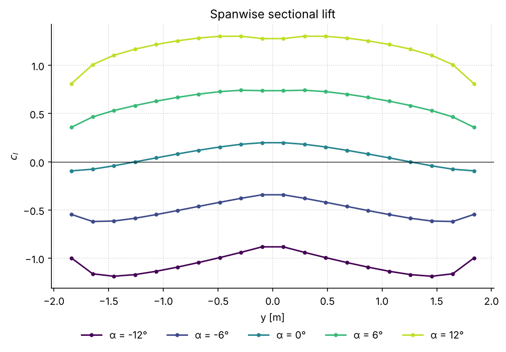

The spanwise lift distribution at five angles of attack, including the central dip that sweep produces.

| | Result (20 spanwise panels) |
|---|---|
| Lift-curve slope | C<sub>Lα</sub> = 0.0932 /deg (5.342 /rad) |
| Lift at zero incidence | C<sub>L,α=0</sub> = 0.068 (cambered NACA 3217) |
| Zero-lift angle | α<sub>L=0</sub> = −0.733° |
| Induced drag | C<sub>Di</sub> = 0.0007 at 0°, 0.0082 at 6°, 0.0288 at 12° |
| Moment about the aerodynamic center | C<sub>M,ac</sub> = 0.034 to 0.055 over −12° to 12° |
| Agreement with XFLR5 | lift slope within 2.6 % |
| Mesh convergence | C<sub>L</sub> changes by < 0.5 % from 80 panels onward |
| Stall redesign | c<sub>l</sub> peak at 5 % of the semispan, dc<sub>l</sub>/dy = −0.200 m⁻¹ |

Every number is produced by `vlmwing` (see [Reproducing the results](#reproducing-the-results)) and checked by the test suite. The baseline numbers match the report in [`docs/`](docs/). Sections 8–10 of the report differ; see [Corrections to the original analysis](#corrections-to-the-original-analysis).

## Quick start

```bash
git clone https://github.com/CPesquero/vlm-wing-aerodynamics.git
cd vlm-wing-aerodynamics
pip install -e .        # or: pip install -e ".[dev]" for tests and linting
vlmwing                 # prints every table and writes all figures to ./figures
```

Use it as a library:

```python
import vlmwing as v

wing = v.Wing.from_planform(area=1.0, aspect_ratio=10, taper=0.5,
                            sweep_c4_deg=20, tip_twist_deg=-3, airfoil="2412")
sol = v.solve(wing, alphas_deg=[0, 5, 10], n_panels=40)

sol.cl        # sectional lift, shape (panels, alphas)
sol.CL        # wing lift coefficient per alpha
sol.CDi       # induced drag (Trefftz plane)
sol.CM_ac     # pitching moment about the aerodynamic center
v.fit_lift_curve(sol).zero_lift_alpha_deg
```

The walkthrough notebook [`notebooks/vlm_analysis.ipynb`](notebooks/vlm_analysis.ipynb) runs the whole study step by step and also opens in Colab.

## The wing

The baseline airfoil is the NACA 3217 (3 % camber at 20 % chord, 17 % thickness). The planform follows from the assignment parameters W = 9, X = 3, Y = 5, Z = 5:

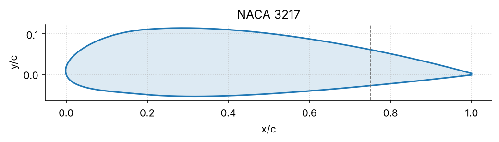

| Parameter | Value |
|---|---|
| Wing area S | 1 m² |
| Aspect ratio A | 15 |
| Taper ratio λ | 0.65 |
| Sweep at quarter chord Λ<sub>c/4</sub> | 12° (12.78° at the leading edge) |
| Geometric twist at the tip ε | −5° (linear washout) |
| Panels | 1 chordwise × 20 spanwise (10 per semispan) |

Derived geometry: span b = 3.873 m, root chord 0.313 m, tip chord 0.203 m, mean aerodynamic chord 0.2619 m, aerodynamic center at (x, y) = (0.2694, 0.8994) m.

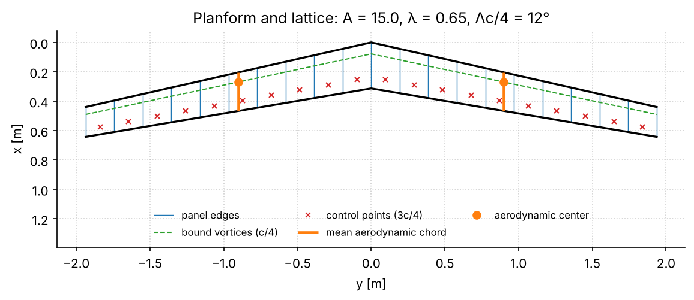

## What it computes

1. **Geometry.** Span, chords, mean aerodynamic chord, aerodynamic center, and the camber-line slope at the 3/4-chord control point (Pistolesi's theorem).
2. **Local lift.** The horseshoe-vortex influence matrix is solved with flow tangency at the 3/4-chord point of each panel, including twist and camber. The Kutta–Joukowski theorem gives the sectional lift.
3. **Global lift.** C<sub>L</sub> is integrated along the span; C<sub>Lα</sub>, C<sub>L,α=0</sub> and α<sub>L=0</sub> come from a straight-line fit.
4. **Basic and additional lift.** The load is split into the part due to camber and twist (at C<sub>L</sub> = 0) and the part per unit C<sub>L</sub>.
5. **Induced drag.** Downwash in the Trefftz plane gives the induced angle and the local and global C<sub>Di</sub>.
6. **Pitching moment.** Taken about the root leading edge and transferred to the aerodynamic center.
7. **Validation.** Point-by-point comparison with XFLR5 at the same stations, and a mesh-convergence study.
8. **Stall redesign.** A five-parameter search for planforms whose stall starts inboard.

```text
Wing ──> Mesh ──> influence matrix ──> circulation ──> c_l(y), C_L, C_Di, C_M
                                            │
                     basic / additional split, XFLR5 comparison, mesh study
                                            │
               planform search (A, Λ, λ, ε, airfoil) ──> closest feasible redesigns
```

## Results

### Lift

Sectional lift rises almost uniformly with α. The global curve is linear over −12° to 12°, as it must be in this attached-flow model.

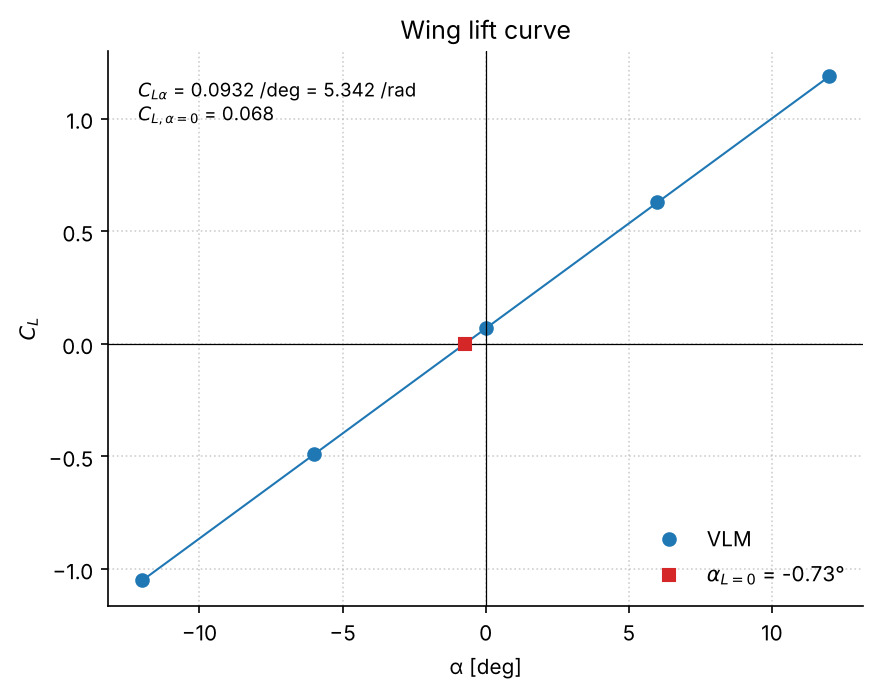

### Basic and additional lift

The basic load (C<sub>L</sub> = 0) is positive inboard and negative at the tips: the −5° washout unloads the tips. The additional load is flatter than elliptical over most of the span and drops near the tips.

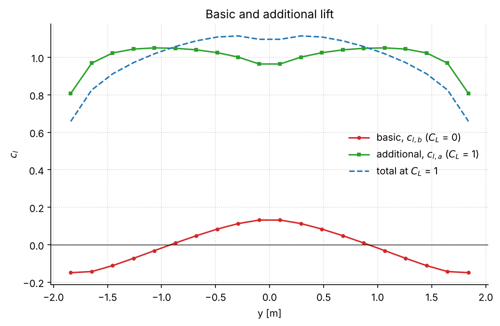

### Induced drag

Induced drag is smallest near zero incidence and grows with |α|. At negative angles it concentrates at the tips, where the washout adds to the negative load.

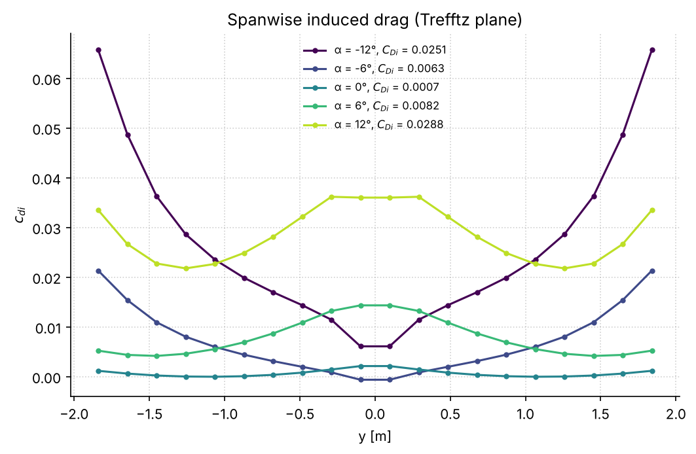

### Pitching moment

About the root leading edge the moment depends strongly on α. About the aerodynamic center it is small and almost flat, which confirms the location of the aerodynamic center. See [Limitations](#limitations) for the small residual trend.

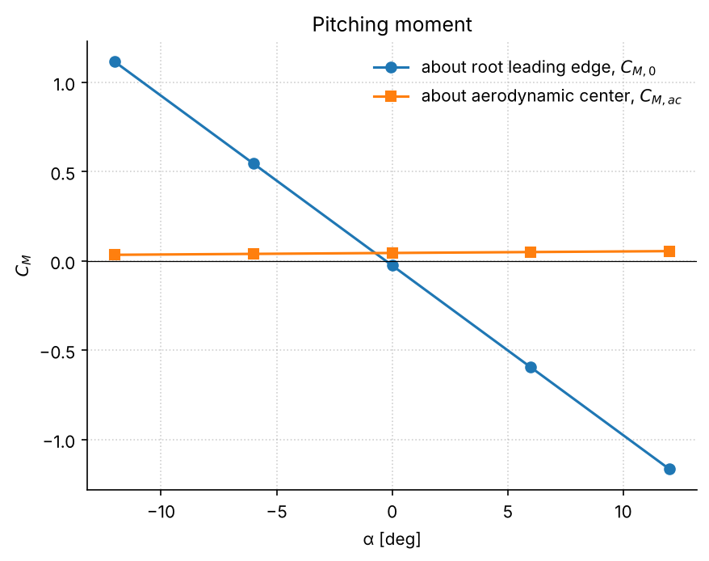

### Comparison with XFLR5

The XFLR5 export uses the same 20 stations, so the comparison is point by point. Both models show the same shape, including the root dip, and the lift slopes agree within 2.6 % (0.0932 vs 0.0909 /deg). There is a near-constant offset of 0.20–0.27 in c<sub>l</sub>, so the zero-lift angles differ. A likely cause is the camber model: this code applies one camber slope at 3c/4, while XFLR5 panels the actual mean line. The agreement is therefore good for slopes and shapes, not for absolute lift.

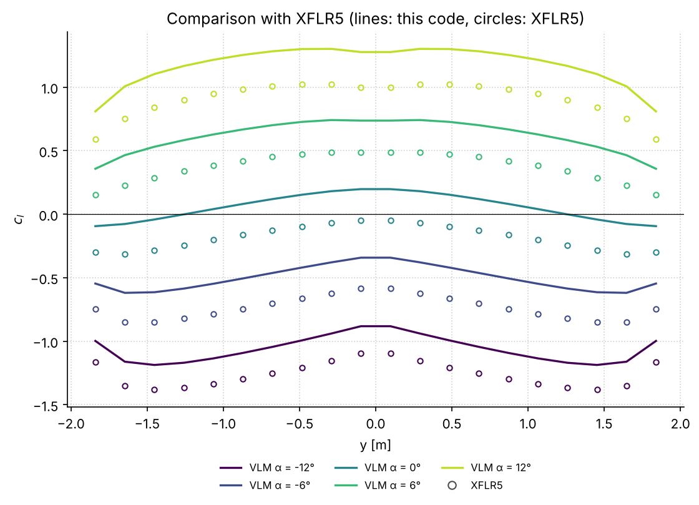

### Mesh convergence

At α = 6°, from 4 to 320 spanwise panels (whole wing). Times are for the vectorized solver, measured in a cloud container; they vary between machines.

| Panels | C<sub>L</sub> | Solve time |
|---|---|---|
| 4 | 0.6394 | 0.2 ms |
| 10 | 0.6336 | 0.2 ms |
| 20 | 0.6277 | 0.3 ms |
| 40 | 0.6232 | 0.4 ms |
| 80 | 0.6207 | 1.0 ms |
| 120 | 0.6199 | 2.3 ms |
| 320 | 0.6188 | 18 ms |

C<sub>L</sub> decreases monotonically and changes by less than 0.5 % beyond 80 panels. The tables above use 20 panels, as the report does; at 80 panels C<sub>L</sub> is 1.1 % lower.

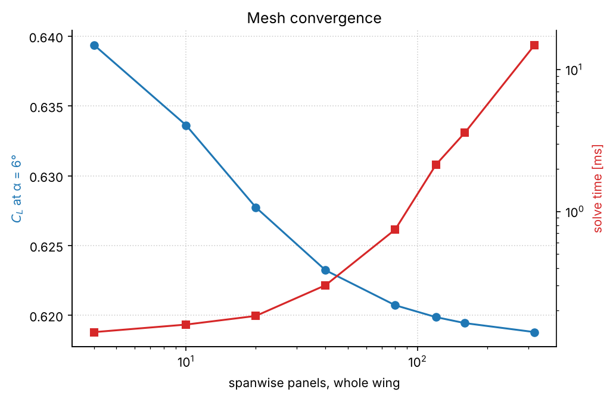

## Stall redesign

**Goal.** At α = 15°, the c<sub>l</sub> peak must lie within 40 % of the semispan, with a spanwise gradient dc<sub>l</sub>/dy ≤ −0.2 m⁻¹ just outboard of it.

**Criterion.** With a spanwise-uniform c<sub>l,max</sub>, the station of peak c<sub>l</sub> is where separation would start. This is a modelling assumption, not a measurement: the VLM does not see the boundary layer.

**Baseline.** The peak is already at 25 % of the semispan, but the gradient is only −0.069 m⁻¹, so the goal is not met.

**Search.** Area is held at 1 m². The code sweeps aspect ratio (15 to 4), quarter-chord sweep (0° to 24°), taper (0.1 to 1), tip twist (0° to −9°) and four airfoils (NACA 0012, 2412, 3217, 4417), about 440 000 designs in a few seconds. Feasible designs are ranked by their normalized distance from the baseline planform.

**Closest feasible designs.**

| | Baseline | Best | 2nd | 3rd |
|---|---|---|---|---|
| Airfoil | NACA 3217 | NACA 0012 | NACA 0012 | NACA 0012 |
| Aspect ratio | 15 | 11.5 | 13.5 | 11.0 |
| Sweep Λ<sub>c/4</sub> | 12° | 3° | 5° | 3° |
| Taper ratio | 0.65 | 1.00 | 1.00 | 1.00 |
| Tip twist | −5° | −8° | −9° | −8° |
| c<sub>l</sub> peak | 25 % | 5 % | 5 % | 5 % |
| dc<sub>l</sub>/dy [m⁻¹] | −0.069 | −0.200 | −0.200 | −0.201 |

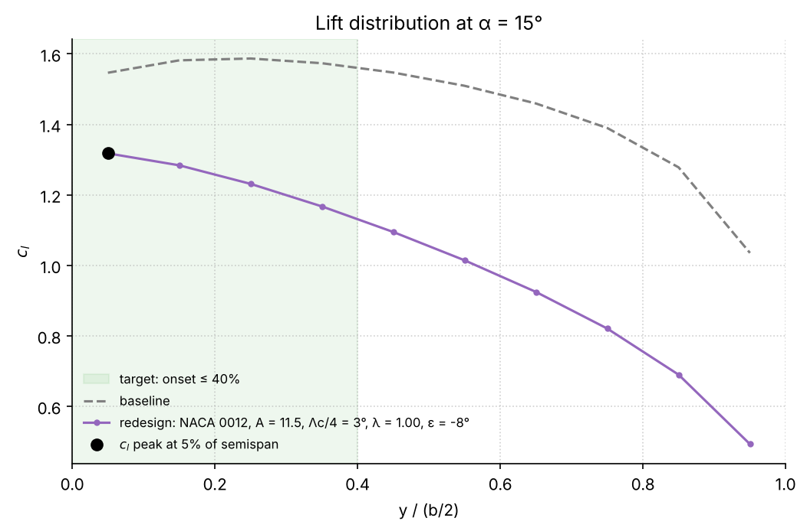

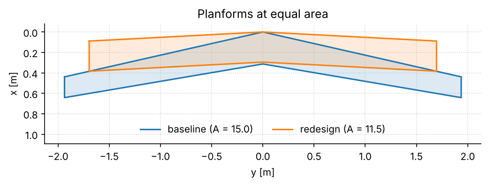

Reading the result: the search drives sweep down and taper up, because both move load inboard, and adds washout to unload the tips. All top designs use the symmetric NACA 0012: in this model the airfoil only enters through its camber slope, and less camber shifts the whole distribution without changing its shape, so it helps meet the gradient threshold. The trade-offs are the same as in the report: more washout risks negative tip lift in cruise, an untapered wing departs from the elliptical load and costs induced drag, and the airfoil change is not a real stall improvement (see Limitations).

## Corrections to the original analysis

Refactoring the notebook into a tested package exposed two problems in sections 8–10 of the original code. Both are fixed here, so those results differ from the PDF report:

1. **Wrong sweep in validation, mesh study and optimization.** Those cells used a hard-coded 20° leading-edge sweep instead of the baseline's 12° quarter-chord sweep (12.78° at the leading edge). They analysed a different wing. With the correct geometry the mesh study reproduces the report's table (C<sub>L</sub> = 0.639 → 0.620).
2. **Area not held constant in the optimization.** The root chord was fixed while the span changed, so the wing area drifted away from 1 m² and the reported aspect ratio (b²/1 m²) was not the real one. The search now builds each wing at constant area.

Also fixed: the XFLR5 loader skipped the first data row (a tip station), and the notebook depended on Google Drive and a download from GitHub.

## Limitations

- **Linear, inviscid, attached flow.** The C<sub>L</sub>–α curve is linear by construction. There is no viscous correction and no real stall prediction.
- **The stall criterion is a proxy.** It locates the lift peak, not boundary-layer separation, and assumes a spanwise-uniform c<sub>l,max</sub>. Swapping airfoils changes only the camber slope here; the change in c<sub>l,max</sub> that matters for real stall is not modelled.
- **One chordwise panel.** All load sits on the quarter-chord line and camber enters through a single slope.
- **XFLR5 agreement is in slope and shape, not absolute value**, as discussed above.
- **C<sub>M,ac</sub> is nearly, not exactly, constant** (0.034 to 0.055 over the α range).
- **Wing alone.** No fuselage, tail or propulsion, so the pitching moment says nothing about aircraft stability.

## Reproducing the results

```bash
pip install -e ".[dev]"
make test       # 40+ tests: report values, physics checks, solver equivalence
make lint       # ruff
make figures    # regenerates figures/*.png and results/results.json
```

`vlmwing --help` lists the options (`--no-optimize`, `--panels`, `--json`, ...). GitHub Actions runs the linter, the tests on Python 3.9–3.13, the command-line reproduction and the notebook on every push.

## Project structure

```text
src/vlmwing/
  geometry.py       Wing, Mesh, NACA camber slope, BASELINE
  solver.py         influence matrix, solve(), CL / CDi / CM, basic-additional split
  validation.py     XFLR5 data loader, mesh convergence
  optimization.py   stall criterion and planform search
  plots.py          every figure in the README
  cli.py            the `vlmwing` command
  data/xflr5_cl.txt XFLR5 sectional lift export
tests/              pytest suite
notebooks/          step-by-step walkthrough
figures/            generated figures
results/            generated numbers (JSON)
docs/               original report (PDF)
```

## Documentation

| Document | What it is |
|---|---|
| [`docs/vlm_aerodynamics_report.pdf`](docs/vlm_aerodynamics_report.pdf) | The original report: derivations, tables, figures and conclusions |
| [`notebooks/vlm_analysis.ipynb`](notebooks/vlm_analysis.ipynb) | Walkthrough of the study with the package |
| [`CHANGELOG.md`](CHANGELOG.md) | What changed from the original notebook |

## References

1. F. Gandía, *Aerodinámica, Cap. VII: Alas en régimen incompresible*, Universidad Politécnica de Madrid.
2. J. J. Bertin and R. M. Cummings, *Aerodynamics for Engineers*, Pearson.
3. A. Deperrois, *XFLR5*.

## Authors

Lucas García Franco and Carlos Pesquero Cañizares. Universidad Politécnica de Madrid, ETSIAE.

If you use this code, please cite it (see [`CITATION.cff`](CITATION.cff)).
